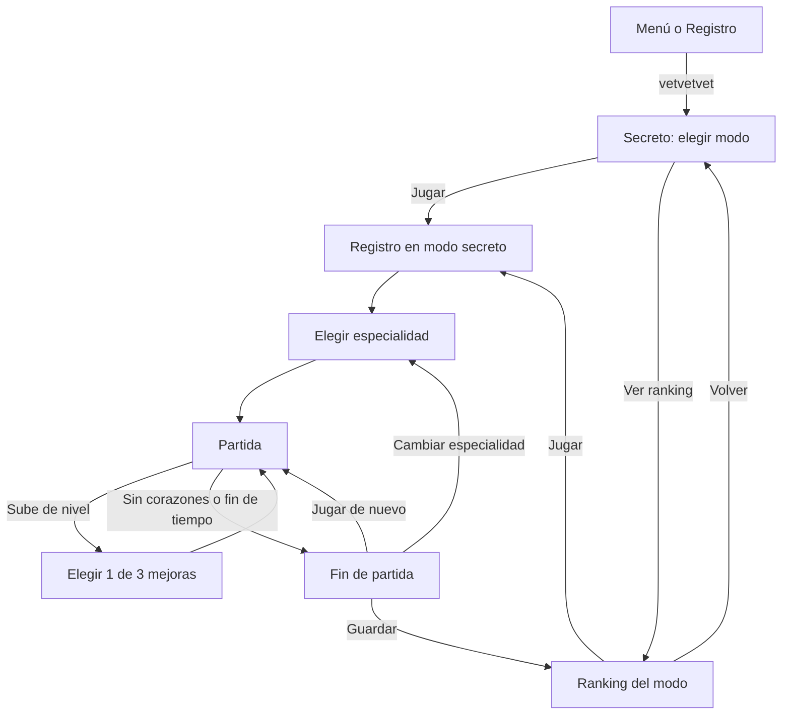

# SDD — Modo secreto "¡Plaga en la recepción!"

| | |
|---|---|
| Proyecto | vet-simulation (¡Siguiente Paciente!, Petsys) |
| Rama | `feature/easter-egg-vetvetvet` |
| Estado | Implementado en el cliente · migración de Supabase escrita, **sin aplicar** |
| Fecha | 2026-10-30 |

## 1. Objetivo

Sumar un easter egg al juego: un modo de acción con otra dinámica que el turno de guardia. Los bichos
(pulgas, garrapatas, mosquitos y una garrapata reina) invaden la recepción de la veterinaria y el
jugador los frena con armas de vacunas, granadas de detergente y la habilidad de su especialidad.
Tiene progresión RPG dentro de la partida (niveles, mejoras, armas) y se juega en el celular con
controles táctiles.

Es un juego propio del género *top-down shooter / roguelite*. No reproduce personajes, niveles, arte
ni nombres de ningún juego existente.

### Fuera de alcance

- Progreso entre partidas (desbloqueos permanentes, monedas, cuentas).
- Multijugador.
- Edición de enemigos u oleadas desde Supabase (todo está en el código).

## 2. Activación

El código secreto es `vetvetvet` (constante `SECRET` en `src/lib/types.ts`).

| Dónde | Cómo |
|---|---|
| PC | Tipearlo en cualquier pantalla fuera de una partida y de un campo de texto (`keydown` global en `App.tsx`). |
| Celular | Escribirlo dentro de cualquier campo del registro. El texto se borra del campo y se abre el modo (`Register.tsx`). |

## 3. Flujo de pantallas

`Screen` suma `secreto` y `bichos`. `App` guarda el `modo` activo (`turno | infinito | tiempo`), y
de eso depende a qué ranking va cada partida.

## 4. Modos de juego

| Modo | Fin de la partida | Reloj |
|---|---|---|
| **Infinito** | Te quedás sin corazones | Cuenta hacia arriba (tiempo aguantado) |
| **Contrarreloj** | Pasan 2 minutos (`TIME_LIMIT = 120`) o te quedás sin corazones | Cuenta regresiva; pita en los últimos 10 s |

Cada modo tiene **su propio ranking**, separado del turno normal y entre sí.

## 5. Controles

| Acción | Celular | Teclado |
|---|---|---|
| Moverse | Arrastrar el dedo sobre la recepción (joystick que aparece donde se apoya) | WASD / flechas |
| Disparar | Mantener **DISPARAR** | J o Z (mantener) |
| Granada de detergente | Botón **GRANADA** | K o X |
| Habilidad de la especialidad | Botón de la habilidad (cuando está cargada) | Espacio, L o C |

El disparo es manual, pero apunta solo al bicho más cercano dentro de 140 px. Si no hay ninguno,
dispara hacia donde mira el veterinario. El joystick y los botones son elementos distintos, así que
se pueden usar con dos dedos a la vez.

## 6. Mecánicas

### 6.1 Escena

La escena es un canvas de 192×256 px lógicos, igual que el juego normal. La recepción tiene paredes
y el escritorio en el centro como obstáculo: frena a los bichos y a todos los disparos. Los bichos
entran por la puerta de abajo, por los costados y por las esquinas de arriba, siempre lejos del
jugador. Antes de cada aparición titila una marca roja durante 0,7 s.

### 6.2 Enemigos

| Bicho | Vida | Velocidad | Comportamiento | Puntos | XP |
|---|---|---|---|---|---|
| Pulga | 1 | 50, a saltos | Persigue saltando | 50 | 1 |
| Garrapata | 4 | 20 | Persigue lento, aguanta | 100 | 2 |
| Mosquito | 2 | 34 | Se queda a 55–75 px, da vueltas y pica de lejos cada 2,2 s | 100 | 2 |
| Garrapata reina | 40 + 5 por oleada | 13 | Jefa: lanza 12 disparos en círculo cada 2,6 s; barra de vida arriba | 500 | 12 |

Desde la oleada 6, la vida de los bichos sube un 50% cada 6 oleadas. El contacto con un bicho o con
un disparo enemigo saca 1 corazón y da 1 s de invulnerabilidad con empuje.

### 6.3 Oleadas

- Oleada normal *n*: `5 + 2n` pulgas, `n` garrapatas y `n − 1` mosquitos (como mucho `4n + 4` bichos).
- Cada 5 oleadas: la garrapata reina más `1 + 2n` pulgas.
- Los bichos entran en grupos de 2 a 4. El intervalo entre grupos baja con la oleada (mínimo 0,35 s)
  y nunca hay más de 45 a la vez (`MAX_BUGS`).
- Entre oleadas hay 2,2 s de descanso. Cada 3 oleadas aparece un **cofre de arma**.
- La música acelera con la oleada (hasta ×1,6).

### 6.4 Armas

| Arma | Disparos/s | Daño | Jeringas | Energía/disparo | Particularidad |
|---|---|---|---|---|---|
| Pistola de vacunas | 4 | 1 | 1 | 0 | Arma inicial, infinita |
| Escopeta antipulgas | 1,7 | 1 | 5 en abanico | 4 | Corto alcance |
| Rociador de vacunas | 11 | 1 | 1, con dispersión | 1 | Muy rápido |
| Jeringota perforante | 1,3 | 5 | 1 | 5 | Atraviesa bichos |

La energía arranca en 100 y se recarga a 7/s. Si no alcanza para disparar, el veterinario vuelve a
la pistola de vacunas. Al agarrar un cofre se cambia el arma y se llena la energía.

### 6.5 Granada de detergente

Se tira en arco (0,45 s) al bicho más cercano dentro de 110 px, o 50 px hacia adelante. Al explotar
hace `4 + daño extra` en un radio de 26 px y deja **espuma** durante 2,5 s, que hace 1 de daño cada
0,5 s y frena a los bichos al 45%. Se arranca con 2 cargas (3 el peluquero) y se recupera 1 cada 6 s.

### 6.6 Especialidades y habilidades

Se elige una antes de cada partida. La habilidad se carga eliminando bichos (6% por bicho).

| Especialidad | Corazones | Velocidad | Extra | Habilidad |
|---|---|---|---|---|
| Clínica general | 6 | 62 | — | **Vacunazo**: onda de 72 px, 8 de daño, borra los disparos enemigos |
| Cirujana | 5 | 68 | +1 de daño | **Bisturís**: 4 bisturís giran a 18 px durante 6 s, 2 + daño extra por golpe |
| Peluquero | 7 | 56 | 3 granadas | **Baño de espuma**: 6 explosiones de espuma alrededor, +1 corazón |

### 6.7 Manada

Cada vez que se pasa una oleada se suma un animal a la manada, hasta 8 (`MAX_PACK`). También se
puede sumar uno con la mejora **Adopción**. Se usan los sprites de mascotas del juego y se suman en
este orden: Toby, Michi, Rocky, Destello, Garfio, Rex Jr., Coca, Luna, Pancho y Copito.

- Sin bichos cerca, los animales se acomodan en ronda alrededor del veterinario.
- Atacan al bicho más cercano a ellos, siempre que esté a menos de 90 px del veterinario.
- No reciben daño, y lo que eliminan suma puntos y XP como si fuera del jugador.

| Animal | Ataque | Daño | Golpes/s | Velocidad |
|---|---|---|---|---|
| Perros (Toby, Copito, Coca) | Mordida | 1 | 1,6–2 | 60–70 |
| Rocky | Mordida | 2 | 1,2 | 64 |
| Gatos (Michi, Garfio, Luna) | Zarpazo | 1 | 2,4–2,6 | 85–88 |
| Rex Jr. (dino) | Mordida | 4 | 0,8 | 55 |
| Pancho (elefante) | Pisotón | 6 | 0,5 | 45 |
| Destello (unicornio) | Dispara brillos a distancia | 1 | 1,4 | 60 |

### 6.8 Niveles y mejoras

Para pasar del nivel *L* al siguiente hacen falta `6 + 5L` de XP. Al subir de nivel el juego se
pausa y se elige 1 de 3 mejoras al azar, entre las que todavía no llegaron a su tope:

| Mejora | Efecto | Tope |
|---|---|---|
| Jeringa doble | +1 jeringa por disparo | +3 |
| Pulso firme | +20% de cadencia | ×2,5 |
| Dosis fuerte | +1 de daño | +4 |
| Zapatillas | +12% de velocidad | 95 |
| Corazón extra | +1 corazón máximo | 10 |
| Curita | +3 corazones | — |
| Más detergente | +1 granada (y recarga todas) | 5 |
| Termo de café | +30 de energía máxima y +3/s de recarga | 220 |
| Adopción | +1 animal a la manada | 8 animales |
| Refuerzo | La habilidad carga 50% más rápido | 20%/bicho |

Además, cada bicho tiene 5% de chance de soltar un corazón, y la reina lo suelta siempre. El corazón
dura 8 s en el piso.

## 7. Puntaje y ranking

- Puntos = suma de los puntos de cada bicho eliminado (siempre múltiplo de 50).
- Al terminar la partida se guarda: nombre, Instagram, veterinaria, puntos, bichos eliminados (en
  `patients`), oleada alcanzada (`wave`) y modo.
- Cada ranking muestra la mejor partida de cada jugador en ese modo.

### 7.1 Cliente (`src/lib/scores.ts`)

- `saveScore(score, modo)` y `topScores(limit, modo)`.
- En modo `turno` **no** manda `p_mode` ni `p_wave`, así el juego normal sigue andando contra la
  base aunque no se haya aplicado la migración.
- Sin Supabase, o si no responde, cada modo usa su propia clave de `localStorage` (`sp-scores`,
  `sp-scores-infinito`, `sp-scores-tiempo`) y sus datos de ejemplo.

### 7.2 Base de datos (`supabase/migrations/20261030180000_modo_bichos.sql`)

Cambios en `public.scores`:

- `mode text not null default 'turno'`, con check en `turno | infinito | tiempo`.
- `wave smallint not null default 0` (0–1000).
- Se amplían los checks de `points` (≤ 1.000.000) y `patients` (≤ 100.000) para el modo infinito.
- Los índices pasan a incluir `mode`.

Funciones (se recrean con firma nueva; las anteriores se borran para que no haya ambigüedad):

- `submit_score(…, p_mode text default 'turno', p_wave integer default 0)`
  - `turno`: la misma validación de antes.
  - `infinito` y `tiempo`: `1 ≤ wave ≤ 1000`, `bichos ≤ 2·wave² + 6·wave + 10` y
    `puntos ≤ bichos·100 + (wave / 5)·400`.
  - Una partida cada 30 s por jugador **y por modo**.
  - El puesto se calcula solo contra el mismo modo.
- `top_scores(lim integer default 10, p_mode text default 'turno')`: mejor partida por jugador en ese modo.

> **Atención:** la migración va contra la base compartida (vetsafe). Hay que revisarla y aplicarla a
> mano (`supabase db push` o el SQL Editor) **con supervisión**. Hasta que se aplique, los modos de
> bichos no pueden guardar en Supabase: devuelven el error genérico de guardado.

## 8. Arquitectura

| Archivo | Responsabilidad |
|---|---|
| `src/game/bichos.ts` | Motor del modo: estado, loop, oleadas, armas, granadas, habilidades, niveles, controles, dibujo y sprites de los bichos. Expone `BichosEngine`, `CLASES`, `WEAPONS` y los íconos. |
| `src/components/Bichos.tsx` | Elección de especialidad (`ClasePicker`), partida (`Partida`): HUD, botonera, elección de mejoras y fin de partida. |
| `src/components/Secreto.tsx` | Pantalla del código secreto: elegir modo o ver su ranking. |
| `src/App.tsx` | Detecta el código, maneja `modo` y deriva cada guardado a su ranking. |
| `src/components/Register.tsx` | Detecta el código en los campos; muestra el modo activo. |
| `src/components/Ranking.tsx` | Ranking por modo. |
| `src/lib/types.ts` | `Modo`, `MODO_NOMBRE`, `SECRET`, nuevas `Screen`. |
| `src/lib/scores.ts` | Guardado y lectura por modo. |
| `src/game/audio.ts` | Efectos nuevos: `shot`, `squish`, `vacuna`. |
| `src/styles.css` | Estilos del modo secreto (HUD, botonera, especialidades, mejoras). |

`BichosEngine` sigue el mismo patrón que `GameEngine`:

- recibe el canvas, la capa de overlay y un callback `onUi`;
- corre su propio `requestAnimationFrame` y le manda a React un `BUi` cada 100 ms, o al instante
  cuando pasa algo;
- React solo dibuja el HUD y llama a `setFiring`, `grenade`, `skill`, `choosePerk` y `start`.

## 9. Plan de pruebas

Automatizadas: `npm run build` (tipos) y `npm run lint`. El repo no tiene tests de juego.

Manual, en el celular y en la PC:

1. Escribir `vetvetvet` en el menú (PC) y en un campo del registro (celular): abre la pantalla secreta
   y el campo queda sin el código.
2. Cada modo, con cada especialidad: moverse, disparar manteniendo el botón y probar varios dedos a la
   vez (moverse + disparar).
3. Granada: explota, deja espuma que frena y se recarga.
4. Habilidades: el vacunazo borra los disparos enemigos, los bisturís giran 6 s, el baño de espuma cura.
5. Subir de nivel: el juego se pausa, se elige una mejora y se retoma sin saltos.
6. Oleada 3: aparece el cofre y se cambia el arma; sin energía vuelve a la pistola.
7. Oleada 5: aparece la reina con su barra de vida.
8. Contrarreloj: termina a los 2:00 con "¡Se terminó el tiempo!".
9. Guardar: el puntaje aparece solo en el ranking de su modo, y el ranking normal no cambia.
10. Con la migración aplicada (en una base de prueba): guardar en cada modo y comprobar que
    `top_scores` separa los modos y que el turno normal sigue guardando igual.

## 10. Pendientes y riesgos

- [ ] Revisar y aplicar la migración en Supabase, con supervisión.
- [ ] Ajustar el balance (vida, cantidad de bichos, recargas) después de jugarlo en el celular.
- [ ] La validación del servidor limita los puntos y bichos posibles, pero no evita que alguien
  invente un puntaje plausible. Es el mismo nivel de seguridad que tiene el ranking normal.
- [ ] Si `vetvetvet` se escribe en un campo del registro con el juego normal elegido, el modo secreto
  se abre igual (es intencional).
